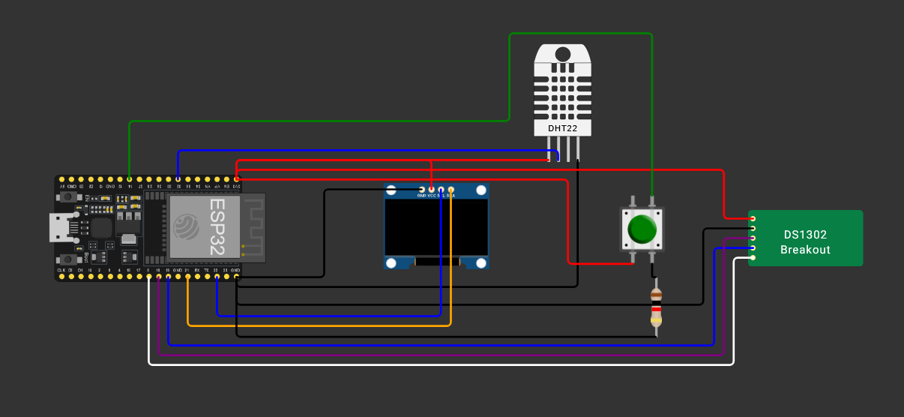

### Overwiev
**NERO Prototype** is a personal project made while learning embedded programming. It is a simple **sensor logger** which measures temperature and humidity with DHT11, measures time via RTC module and displays it on the SSD1306 OLED screen.

The logger also features a simple interface with two pages:
    1. Current time and date
    2. The temperature and humidity

*No AI was used neither during assembling the pieces nor during code writing*.
*(not even for writing this README)*

### Parts list
- ESP32 DevKit 38pin (based on ESP32-WROOM-32)
- SSD1306 OLED 0.96"
- DHT11
- RTC DS1302
- a Button for display controls

### Assembly scheme

### How it works?
Very simple. Push the button to change the page and behold the data on a screen :)
